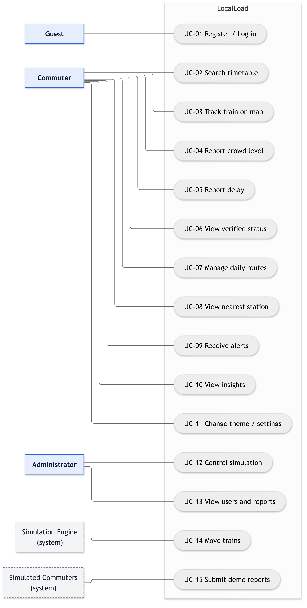

# Use Cases

## Actors

| Actor | Type | Description |
|--------------------|------------|--------------------------------------------------------------------|
| Guest | Primary | A person who has not logged in. A guest can only view the welcome screen, register and log in; every tab of the application requires authentication. |
| Commuter | Primary | A registered user. Searches trains, tracks them on the map, reports crowd and delay, manages daily routes and receives alerts. |
| Administrator | Primary | A user whose role is `admin` (created by the seed script). Controls the simulation and views users, reports and verification counts. |
| Simulation Engine | System | A server component that moves the demonstration trains and raises arrival events. |
| Simulated Commuters | System | Labelled demonstration accounts that periodically submit crowd and delay reports for running trains. |

## Use-case diagram

{height=8.4in}

## Use-case descriptions

| ID | Use case | Actor(s) | Main flow | Result |
|----------|--------------|-------------|-------------------------------------|------------------------|
| UC-01 | Register / log in | Guest | The guest enters name, email and password (registration) or email and password (login). The server validates the input, hashes the password with bcrypt and returns a JWT. | The user is authenticated; the token is stored in secure storage. |
| UC-02 | Search timetable | Commuter | The commuter enters a train number or name, or selects source and destination stations, line, type and direction. | Matching demonstration trains are listed with scheduled times and status. |
| UC-03 | Track train on map | Commuter | The commuter opens a train. The app loads a snapshot over REST, then joins the train's Socket.IO room. | The map shows the route, stations and a moving marker with next station, ETA, speed and distance. |
| UC-04 | Report crowd level | Commuter | The commuter selects a running train, the reporting station and a level (green, yellow, red) and submits. | The report is stored unless the user already voted there in the last 10 minutes; the recomputed status is broadcast. |
| UC-05 | Report delay | Commuter | As UC-04, choosing one of six delay categories. | As UC-04, for delay status. |
| UC-06 | View verified status | Commuter | The commuter views a train card, the tracking screen or the live feed. | The status is shown as *Unverified n/5*, *Mixed* or *Confirmed*, with the names of the reporters. |
| UC-07 | Manage daily routes | Commuter | The commuter creates, edits or deletes a route (name, line, source, destination, preferred time, fast/slow preference). | Routes are stored against the user and shown on Home with the next matching trains. |
| UC-08 | View nearest station | Commuter | The app requests foreground location permission and sends the coordinates to the server once. | The nearest station, its lines, distance and walking time are shown. |
| UC-09 | Receive alerts | Commuter (triggered by the Simulation Engine or by reports) | A confirmed status changes on a saved route, or a train with a confirmed green or yellow status arrives at the user's nearest station. | A notification is stored and shown on the device. |
| UC-10 | View insights | Commuter | The commuter opens the Insights tab, which shows the current weekday by default. The commuter may choose another weekday from a drop-down list, or switch to *By date* and pick a day in the calendar. | Hourly, morning/evening, station and train statistics for the selected weekday or date are displayed, together with the weekly trend. An empty state is shown for a date without reports. |
| UC-11 | Change theme / settings | Commuter | The commuter selects light, dark or system theme and toggles alert types. | Preferences are saved (theme on the device, alert settings on the server). |
| UC-12 | Control simulation | Administrator | The administrator starts, stops or resets the simulation or changes its speed multiplier. | The simulation state changes for all users. |
| UC-13 | View users and reports | Administrator | The administrator opens the Admin screen. | Lists of users, recent reports and live verification counts are shown. |
| UC-14 | Move trains | Simulation Engine | On every tick, positions are interpolated and broadcast; arrivals raise events. | Positions are updated and persisted. |
| UC-15 | Submit demo reports | Simulated Commuters | At a fixed interval a group of demonstration accounts reports on a running train at its current station. | The live feed is updated; route alerts are not triggered. |
