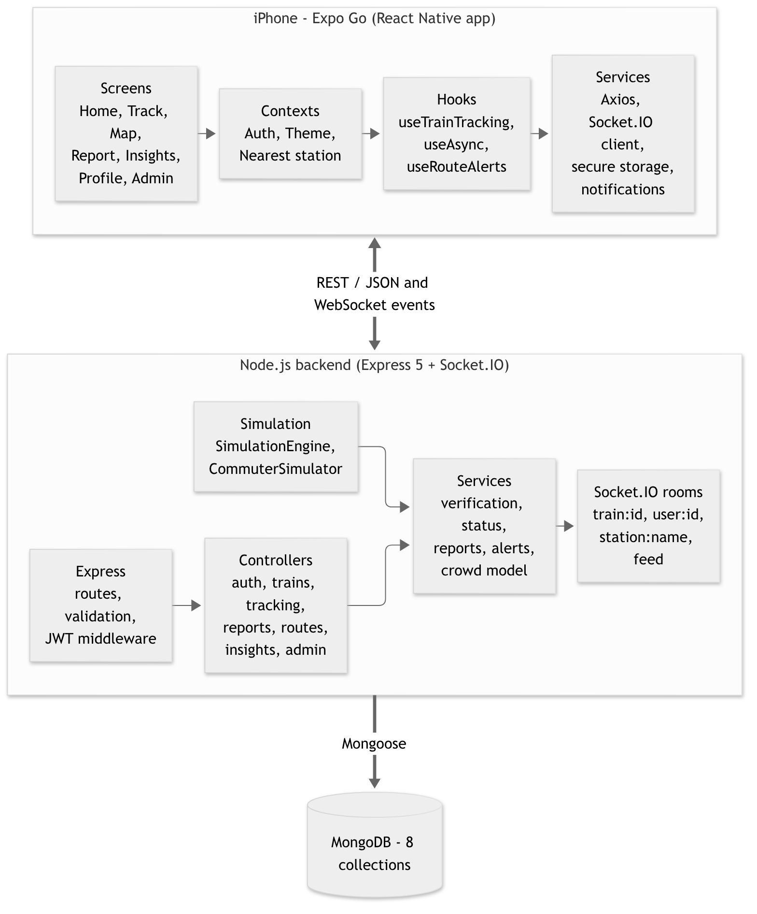
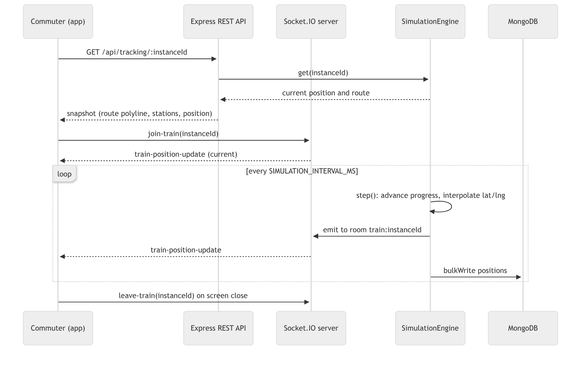

# System Architecture

LocalLoad follows a client–server architecture with three tiers: a mobile client, an application server and a document database. Real-time data flows from the server to the client over WebSockets, and all other communication uses a JSON REST API.

{width=100%}

## Mobile client

The client is a React Native application built with Expo SDK 58 and written in TypeScript.

- **Navigation.** A native stack navigator holds a bottom-tab navigator (Home, Track, Report, Insights, Profile) and the detail screens (live tracking map, route form, notifications, admin). When no user is logged in, a separate authentication stack (Welcome, Login, Signup) is shown.
- **State.** React contexts hold the authenticated user (`AuthContext`), the theme (`ThemeContext`) and the nearest station (`NearestStationContext`). Screen data is loaded through a small `useAsync` hook that exposes loading, error and reload states.
- **Services.** An Axios instance attaches the JWT to every request. A single long-lived Socket.IO client is shared by all hooks, and its authentication token is replaced on login and logout. A notification helper displays local notifications.

## Application server

The server is a Node.js application using Express 5 and TypeScript, organised in layers:

1. **Routes** (`server/src/routes/index.ts`) declare endpoints, validation chains and the authentication and authorisation middleware.
2. **Controllers** translate HTTP requests into service calls and shape responses.
3. **Services** contain the business logic: verification, status aggregation, report submission, alerts, the crowd model and timetable search.
4. **Models** define the Mongoose schemas and indexes.
5. **Simulation** contains the `SimulationEngine`, which moves trains, and the `CommuterSimulator`, which submits demonstration reports.
6. **Sockets** configure the Socket.IO rooms and events.

## Real-time communication

| Room | Members | Events sent to the room |
|------------------------|----------------------------------|------------------------------------------|
| `train:<instanceId>` | Clients on that train's tracking screen | `train-position-update`, `crowd-status-update`, `delay-status-update` |
| `user:<userId>` | All connections of an authenticated user | `route-alert` (saved-route and nearest-station alerts) |
| `station:<name>` | Users whose nearest station is `<name>` | Used by the server to find recipients of arrival alerts |
| `feed` | Clients showing the Home screen | `feed-update` (a small notification that new reports exist) |

Clients emit `join-train`, `leave-train`, `join-feed`, `leave-feed` and `watch-station`.

{width=100%}

## REST API

The following table is generated from the route definitions.

<!-- AUTO:api -->
<!-- This block is generated by scripts/report/generate.mjs from server/src/routes/index.ts. Do not edit by hand; run scripts/build_report.sh. -->

| Method | Path | Access | Handler |
|----------|----------------------------------------|----------------------|----------------------------|
| POST | `/api/auth/register` | Public | `auth.register` |
| POST | `/api/auth/login` | Public | `auth.login` |
| GET | `/api/auth/me` | Authenticated (JWT) | `auth.me` |
| GET | `/api/stations` | Public | `stations.listStations` |
| GET | `/api/stations/nearest` | Public | `stations.nearestStations` |
| GET | `/api/stations/:id` | Public | `stations.getStation` |
| GET | `/api/trains` | Public | `trains.listTrains` |
| GET | `/api/trains/search` | Public | `trains.listTrains` |
| GET | `/api/trains/:id` | Public | `trains.getTrain` |
| GET | `/api/trains/:id/status` | Public | `trains.trainStatus` |
| GET | `/api/tracking/active` | Public | `tracking.activeTrains` |
| GET | `/api/tracking/:trainInstanceId` | Public | `tracking.trackInstance` |
| POST | `/api/reports/crowd` | Authenticated (JWT) | `reports.submitCrowd` |
| POST | `/api/reports/delay` | Authenticated (JWT) | `reports.submitDelay` |
| GET | `/api/reports/crowd/:trainInstanceId` | Public | `reports.crowdReportsFor` |
| GET | `/api/crowd/recent` | Public | `reports.recentCrowd` |
| GET | `/api/crowd/status/:trainInstanceId` | Public | `reports.crowdStatus` |
| GET | `/api/delay/status/:trainInstanceId` | Public | `reports.delayStatus` |
| POST | `/api/routes` | Authenticated (JWT) | `routes.createRoute` |
| GET | `/api/routes` | Authenticated (JWT) | `routes.listRoutes` |
| PUT | `/api/routes/:id` | Authenticated (JWT) | `routes.updateRoute` |
| DELETE | `/api/routes/:id` | Authenticated (JWT) | `routes.deleteRoute` |
| GET | `/api/insights/overview` | Public | `insights.overview` |
| GET | `/api/insights/weekly` | Public | `insights.weekly` |
| GET | `/api/insights/dates` | Public | `insights.datesWithData` |
| GET | `/api/insights/station/:stationId` | Public | `insights.stationInsights` |
| GET | `/api/notifications` | Authenticated (JWT) | `notifications.listNotifications` |
| PUT | `/api/notifications/settings` | Authenticated (JWT) | `notifications.updateSettings` |
| PUT | `/api/notifications/read` | Authenticated (JWT) | `notifications.markAllRead` |
| GET | `/api/admin/users` | Admin (JWT + role) | `admin.users` |
| GET | `/api/admin/reports` | Admin (JWT + role) | `admin.reports` |
| GET | `/api/admin/verification` | Admin (JWT + role) | `admin.verification` |
| GET | `/api/admin/simulation/status` | Admin (JWT + role) | `admin.simulationStatus` |
| POST | `/api/admin/simulation/start` | Admin (JWT + role) | `admin.startSimulation` |
| POST | `/api/admin/simulation/stop` | Admin (JWT + role) | `admin.stopSimulation` |
| POST | `/api/admin/simulation/reset` | Admin (JWT + role) | `admin.resetSimulation` |
| POST | `/api/admin/simulation/speed` | Admin (JWT + role) | `admin.setSpeed` |
<!-- /AUTO:api -->
