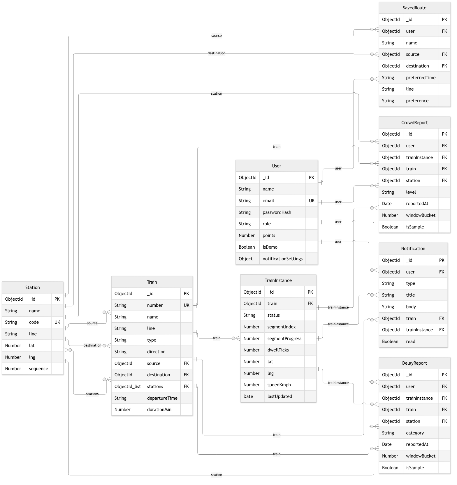

# Database Design

The system stores its data in MongoDB, accessed through Mongoose. MongoDB was chosen because the data is naturally document-shaped (for example, a train with an ordered list of station references), because Mongoose provides schemas, validation and indexes, and because the aggregation pipeline is well suited to the statistics in the Insights screen.

Documents reference each other through `ObjectId` fields instead of embedding, so that stations, trains and users are stored once and shared. Mongoose `timestamps` adds `createdAt` and `updatedAt` to every collection.

## Entity–relationship diagram

The diagram below is generated from the Mongoose model files by `scripts/report/generate.mjs`. `FK` marks a reference to another collection and `UK` a unique field. Fields typed `ObjectId_list` are arrays of references.

{width=100%}

## Design notes

- **Stations per line.** A station that is served by two lines (for example Dadar on the Western and Central lines) is stored once per line, with a line-specific code (`W-DDR`, `C-DR`), because its sequence and coordinates differ per line. Search and nearest-station queries match on the station *name*, so the user sees a single station.
- **Train versus train instance.** `Train` holds the static timetable entry. `TrainInstance` holds the mutable state of its running copy in the simulation (current segment, progress, coordinates, speed). Reports refer to the instance.
- **Duplicate-vote protection.** `CrowdReport` and `DelayReport` store a `windowBucket`, equal to the report time divided by the reporting window and rounded down. A unique compound index on `{user, trainInstance, station, windowBucket}` prevents two stored votes by the same user for the same train and station in the same window, even under concurrent requests.
- **Time zone.** Report times are stored in UTC; all grouping by hour, weekday and date for the Insights screen is done in the `Asia/Kolkata` time zone inside the aggregation pipeline, so that "Monday" and "8 am" refer to Mumbai time.
- **Sample data.** Reports created by the seed script carry `isSample: true`. Seeded demonstration accounts carry `isDemo: true`. Both flags are used to label data in the interface and to exclude sample data where needed.

## Collections

The following descriptions are generated from the model definitions.

<!-- AUTO:collections -->
<!-- This block is generated by scripts/report/generate.mjs from server/src/models/*.ts. Do not edit by hand; run scripts/build_report.sh. -->

### Collection `crowdreports` (model `CrowdReport`)

Source: `server/src/models/CrowdReport.ts`. Mongoose `timestamps` adds `createdAt` and `updatedAt`.

| Field | Type | References | Constraints / notes |
|------------------------|----------------|----------------|--------------------------------------------|
| `_id` | ObjectId | — | primary key |
| `user` | ObjectId | User | required |
| `trainInstance` | ObjectId | TrainInstance | required |
| `train` | ObjectId | Train | required |
| `station` | ObjectId | Station | required |
| `level` | String | — | required; enum (CROWD_LEVELS) |
| `reportedAt` | Date | — | default Date.now |
| `windowBucket` | Number | — | required |
| `isSample` | Boolean | — | default false; seeded historical demo data |

Compound indexes: `{ user: 1, trainInstance: 1, station: 1, windowBucket: 1 }` (unique), `{ trainInstance: 1, station: 1, reportedAt: -1 }`, `{ reportedAt: -1 }`.

### Collection `delayreports` (model `DelayReport`)

Source: `server/src/models/DelayReport.ts`. Mongoose `timestamps` adds `createdAt` and `updatedAt`.

| Field | Type | References | Constraints / notes |
|------------------------|----------------|----------------|--------------------------------------------|
| `_id` | ObjectId | — | primary key |
| `user` | ObjectId | User | required |
| `trainInstance` | ObjectId | TrainInstance | required |
| `train` | ObjectId | Train | required |
| `station` | ObjectId | Station | required |
| `category` | String | — | required; enum (DELAY_CATEGORIES) |
| `reportedAt` | Date | — | default Date.now |
| `windowBucket` | Number | — | required |
| `isSample` | Boolean | — | default false |

Compound indexes: `{ user: 1, trainInstance: 1, station: 1, windowBucket: 1 }` (unique), `{ trainInstance: 1, station: 1, reportedAt: -1 }`.

### Collection `notifications` (model `Notification`)

Source: `server/src/models/Notification.ts`. Mongoose `timestamps` adds `createdAt` and `updatedAt`.

| Field | Type | References | Constraints / notes |
|------------------------|----------------|----------------|--------------------------------------------|
| `_id` | ObjectId | — | primary key |
| `user` | ObjectId | User | required |
| `type` | String | — | required; enum [crowd, delay, nearby, info] |
| `title` | String | — | required |
| `body` | String | — | required |
| `train` | ObjectId | Train | — |
| `trainInstance` | ObjectId | TrainInstance | — |
| `read` | Boolean | — | default false |

Compound indexes: `{ user: 1, createdAt: -1 }`.

### Collection `savedroutes` (model `SavedRoute`)

Source: `server/src/models/SavedRoute.ts`. Mongoose `timestamps` adds `createdAt` and `updatedAt`.

| Field | Type | References | Constraints / notes |
|------------------------|----------------|----------------|--------------------------------------------|
| `_id` | ObjectId | — | primary key |
| `user` | ObjectId | User | required; indexed |
| `name` | String | — | required |
| `source` | ObjectId | Station | required |
| `destination` | ObjectId | Station | required |
| `preferredTime` | String | — | required; "HH:mm" |
| `line` | String | — | required; enum (LINES) |
| `preference` | String | — | enum [fast, slow, any]; default 'any' |

### Collection `stations` (model `Station`)

Source: `server/src/models/Station.ts`. Mongoose `timestamps` adds `createdAt` and `updatedAt`.

One record per station *per line* (Dadar on Western and Central are separate records).

| Field | Type | References | Constraints / notes |
|------------------------|----------------|----------------|--------------------------------------------|
| `_id` | ObjectId | — | primary key |
| `name` | String | — | required |
| `code` | String | — | required; unique |
| `line` | String | — | required; enum (LINES) |
| `lat` | Number | — | required |
| `lng` | Number | — | required |
| `sequence` | Number | — | required; order along the line, starting from the city terminus |

Compound indexes: `{ line: 1, sequence: 1 }`.

### Collection `trains` (model `Train`)

Source: `server/src/models/Train.ts`. Mongoose `timestamps` adds `createdAt` and `updatedAt`.

Static timetable entry (SIMULATED timetable - not official railway data).

| Field | Type | References | Constraints / notes |
|------------------------|----------------|----------------|--------------------------------------------|
| `_id` | ObjectId | — | primary key |
| `number` | String | — | required; unique |
| `name` | String | — | required |
| `line` | String | — | required; enum (LINES) |
| `type` | String | — | required; enum [fast, slow] |
| `direction` | String | — | required; enum [up, down]; down = away from Churchgate/CSMT |
| `source` | ObjectId | Station | required |
| `destination` | ObjectId | Station | required |
| `stations` | ObjectId[] | Station | required; ordered halts |
| `departureTime` | String | — | required; "HH:mm" |
| `durationMin` | Number | — | required |

Compound indexes: `{ line: 1, type: 1, direction: 1 }`.

### Collection `traininstances` (model `TrainInstance`)

Source: `server/src/models/TrainInstance.ts`. Mongoose `timestamps` adds `createdAt` and `updatedAt`.

A running copy of a train in the simulation. The simulation engine owns this state and writes it back to MongoDB on every tick.

| Field | Type | References | Constraints / notes |
|------------------------|----------------|----------------|--------------------------------------------|
| `_id` | ObjectId | — | primary key |
| `train` | ObjectId | Train | required; unique |
| `status` | String | — | enum [running, at-station, completed]; default 'at-station' |
| `segmentIndex` | Number | — | default 0; index of the station the train last left / is at |
| `segmentProgress` | Number | — | default 0; 0..1 along the segment to the next station |
| `dwellTicks` | Number | — | default 0 |
| `lat` | Number | — | — |
| `lng` | Number | — | — |
| `speedKmph` | Number | — | default 0 |
| `lastUpdated` | Date | — | — |

### Collection `users` (model `User`)

Source: `server/src/models/User.ts`. Mongoose `timestamps` adds `createdAt` and `updatedAt`.

| Field | Type | References | Constraints / notes |
|------------------------|----------------|----------------|--------------------------------------------|
| `_id` | ObjectId | — | primary key |
| `name` | String | — | required |
| `email` | String | — | required; unique |
| `passwordHash` | String | — | required; hidden by default |
| `role` | String | — | enum [user, admin]; default 'user' |
| `points` | Number | — | default 0; simple contribution counter: +1 per accepted report |
| `isDemo` | Boolean | — | default false; seeded demo / simulated commuter account |
| `notificationSettings` | Object | — | embedded: enabled, crowd, delay, nearby |
<!-- /AUTO:collections -->
