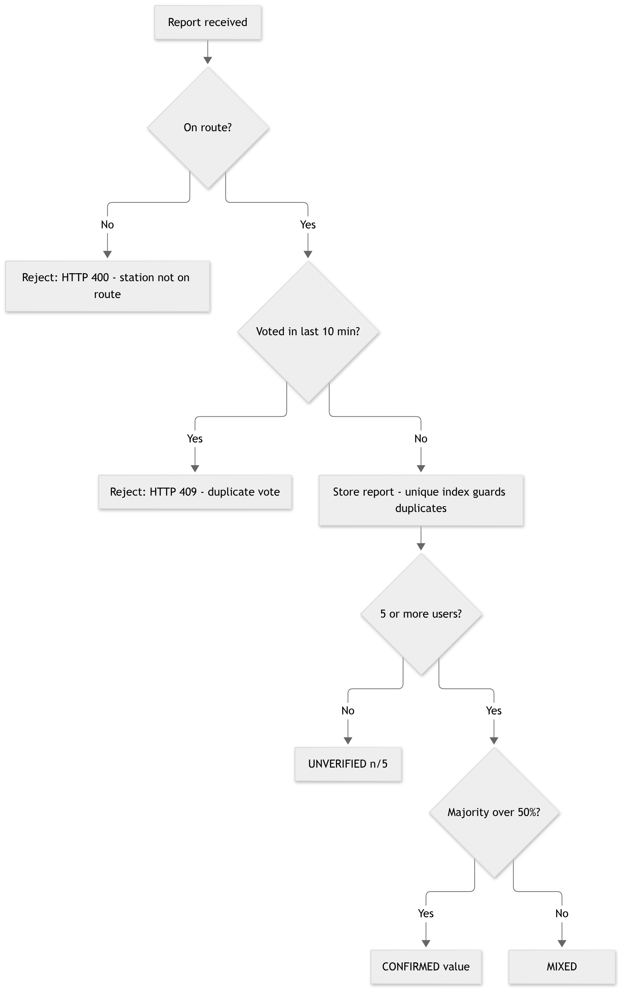

# Core Logic

This chapter explains the main algorithms of the system. Every code listing is extracted automatically from the named function or class in the source file, so it always matches the current code.

## Five-user verification

The verification of crowd and delay reports is implemented as a pure function. Given all votes for a train instance and station, it keeps only the votes inside the reporting window and only the latest vote of each user. It then applies three rules:

1. fewer than the threshold (five) distinct users gives **unverified**;
2. a value whose count is more than half of the votes gives **confirmed**;
3. otherwise the result is **mixed**, which includes every tie.

{height=8in}

<!-- SNIPPET: server/src/services/verification.ts#computeVerdict -->
*Source: `server/src/services/verification.ts`, lines 39–78 (`computeVerdict`).*

```typescript
export function computeVerdict<T extends string>(votes: VoteInput<T>[], opts: VerdictOptions<T>): Verdict<T> {
  const now = (opts.now ?? new Date()).getTime();
  const windowStart = now - opts.windowMs;

  // Steps 1 + 2: keep only recent votes, and only the latest vote per user.
  const latestByUser = new Map<string, VoteInput<T>>();
  for (const v of votes) {
    const t = v.reportedAt.getTime();
    if (t < windowStart || t > now) continue;
    const prev = latestByUser.get(v.user);
    if (!prev || prev.reportedAt.getTime() < t) latestByUser.set(v.user, v);
  }
  const valid = [...latestByUser.values()];

  const distribution = Object.fromEntries(opts.categories.map((c) => [c, 0])) as Record<T, number>;
  for (const v of valid) distribution[v.value] = (distribution[v.value] ?? 0) + 1;

  const total = valid.length;
  const lastUpdated = total ? new Date(Math.max(...valid.map((v) => v.reportedAt.getTime()))) : null;
  const base = { total, threshold: opts.threshold, distribution, lastUpdated };

  if (total === 0) {
    return { ...base, state: 'none', value: null, message: `No reports yet — 0/${opts.threshold} reports received.` };
  }
  // Step 3: not enough distinct users yet.
  if (total < opts.threshold) {
    return {
      ...base,
      state: 'unverified',
      value: null,
      message: `Insufficient reports — ${total}/${opts.threshold} reports received.`,
    };
  }
  // Step 4: strict majority (count * 2 > total). A tie can never be a strict majority.
  const winner = opts.categories.find((c) => distribution[c] * 2 > total);
  if (!winner) {
    return { ...base, state: 'mixed', value: null, message: 'Mixed reports — no clear consensus.' };
  }
  return { ...base, state: 'confirmed', value: winner, message: `Confirmed by ${distribution[winner]} of ${total} reports.` };
}
```
<!-- /SNIPPET -->

The window bucket used by the unique database index is computed as follows:

<!-- SNIPPET: server/src/services/verification.ts#windowBucket -->
*Source: `server/src/services/verification.ts`, lines 80–81 (`windowBucket`).*

```typescript
/** Window bucket used by the unique index to block duplicate votes at the database level. */
export const windowBucket = (date: Date, windowMs: number) => Math.floor(date.getTime() / windowMs);
```
<!-- /SNIPPET -->

Worked examples, all covered by automated tests in `server/src/tests/verification.test.ts`:

| Votes from distinct users | Result |
|--------------------------------------------------|--------------------------------------------------|
| Green 1, Yellow 1, Red 3 | Confirmed red (3 of 5 is a strict majority) |
| Green 1, Yellow 1, Red 2 | Unverified, 4/5 |
| Green 3, Yellow 3 | Mixed (3 of 6 is not more than half) |
| One user voting six times | Counted once |
| Five red votes older than 10 minutes and two new green votes | Only the two green votes count: unverified, 2/5 |
| Green 2, Yellow 2, Red 1 | Mixed |

## Report submission

All reports, from the API and from the simulated commuters, pass through one service function. It checks the route, rejects duplicates, stores the report, recomputes the verdict, broadcasts the status, and sends route alerts only when the *confirmed* value changes.

<!-- SNIPPET: server/src/services/reports.ts#submitReport -->
*Source: `server/src/services/reports.ts`, lines 9–75 (`submitReport`).*

```typescript
/**
 * Shared flow for crowd and delay reports (used by the API and by simulated commuters):
 *  1. check the train instance exists and the station is on its route
 *  2. reject if this user already has an active vote here (10-minute window) -> 409
 *  3. store the report (unique DB index is the final guard against duplicates)
 *  4. recompute the verdict, broadcast it to the train's room and to the live feed
 *  5. if the CONFIRMED value changed (and notify is on), send route alerts
 */
export async function submitReport(
  kind: Kind,
  userId: string,
  trainInstanceId: string,
  stationId: string,
  value: string,
  opts: { notify?: boolean } = {},
) {
  const { model, field } = KIND_CONFIG[kind];

  const instance: any = await TrainInstance.findById(trainInstanceId).populate('train', 'stations').lean();
  if (!instance) throw new HttpError(404, 'Train instance not found');
  if (!instance.train.stations.some((s: unknown) => String(s) === stationId)) {
    throw new HttpError(400, 'This station is not on the selected train route');
  }
  const station = await Station.findById(stationId).select('name').lean();

  const now = new Date();
  const before = await recentVotes(kind, trainInstanceId, stationId, now);
  const mine = before.find((v: { user: string }) => v.user === userId);
  if (mine) {
    const waitMin = Math.ceil((mine.reportedAt.getTime() + env.reportWindowMs - now.getTime()) / 60000);
    throw new HttpError(409, `You already reported for this train at this station. You can report again in ${waitMin} min.`);
  }

  try {
    await (model as any).create({
      user: userId,
      trainInstance: trainInstanceId,
      train: instance.train._id,
      station: stationId,
      [field]: value,
      reportedAt: now,
      windowBucket: windowBucket(now, env.reportWindowMs),
    });
  } catch (err: any) {
    if (err?.code === 11000) throw new HttpError(409, 'You already reported for this train at this station in this window.');
    throw err;
  }
  await User.updateOne({ _id: userId }, { $inc: { points: 1 } });

  const after = [...before, { user: userId, value, reportedAt: now }];
  const oldVerdict = verdictFor(kind, before, now);
  const newVerdict = verdictFor(kind, after, now);

  const status = await instanceStatus(kind, trainInstanceId);
  runtime.io?.to(`train:${trainInstanceId}`).emit(`${kind}-status-update`, status);
  // Lightweight ping for screens showing the live feed (Home). They re-fetch what they need.
  runtime.io?.to('feed').emit('feed-update', { kind, trainInstanceId, stationId });

  const confirmedChanged =
    newVerdict.state === 'confirmed' && (oldVerdict.state !== 'confirmed' || oldVerdict.value !== newVerdict.value);
  if (confirmedChanged && opts.notify !== false) {
    await sendRouteAlerts(kind, trainInstanceId, station?.name ?? 'a station', newVerdict.value!).catch((e) =>
      console.error('[alerts]', e),
    );
  }
  return { verdict: newVerdict, status };
}
```
<!-- /SNIPPET -->

## Simulated train movement

A train's position on a segment is described by `progress`, a number from 0 at the previous station to 1 at the next station. The coordinates are obtained by linear interpolation, which is adequate over the few kilometres between suburban stations:

<!-- SNIPPET: server/src/utils/geo.ts#interpolate -->
*Source: `server/src/utils/geo.ts`, lines 16–24 (`interpolate`).*

```typescript
/**
 * Linear interpolation between two coordinates.
 * t = 0 -> point a, t = 1 -> point b, t = 0.5 -> halfway.
 * Over the few kilometres between two suburban stations a straight line is accurate enough.
 */
export function interpolate(a: LatLng, b: LatLng, t: number): LatLng {
  const k = Math.min(1, Math.max(0, t));
  return { lat: a.lat + (b.lat - a.lat) * k, lng: a.lng + (b.lng - a.lng) * k };
}
```
<!-- /SNIPPET -->

Distances are computed with the haversine formula:

<!-- SNIPPET: server/src/utils/geo.ts#distanceKm -->
*Source: `server/src/utils/geo.ts`, lines 6–14 (`distanceKm`).*

```typescript
/** Great-circle distance between two coordinates in kilometres (haversine formula). */
export function distanceKm(a: LatLng, b: LatLng): number {
  const R = 6371;
  const toRad = (d: number) => (d * Math.PI) / 180;
  const dLat = toRad(b.lat - a.lat);
  const dLng = toRad(b.lng - a.lng);
  const h = Math.sin(dLat / 2) ** 2 + Math.cos(toRad(a.lat)) * Math.cos(toRad(b.lat)) * Math.sin(dLng / 2) ** 2;
  return 2 * R * Math.asin(Math.sqrt(h));
}
```
<!-- /SNIPPET -->

On each tick, `step` advances one train. A halted train counts down its dwell time. A running train's speed follows a sine curve, slower near stations and fastest mid-segment. Progress grows by the distance travelled divided by the segment length, and on reaching the next station the train either halts or, at the terminus, rests and later restarts. The method returns the station reached, which is used for arrival alerts.

<!-- SNIPPET: server/src/simulation/engine.ts#SimulationEngine.step -->
*Source: `server/src/simulation/engine.ts`, lines 184–232 (`SimulationEngine.step`).*

```typescript
/** Moves one train. Returns the station it just arrived at, if any. */
private step(t: SimTrain, hours: number): RouteStop | null {
  t.lastUpdated = new Date();
  const last = t.route.length - 1;

  if (t.status === 'completed') {
    if (--t.dwellTicks <= 0) {
      // loop the demo: restart from the origin
      t.status = 'at-station';
      t.segmentIndex = 0;
      t.progress = 0;
      t.dwellTicks = DWELL_TICKS;
    }
    t.speed = 0;
    this.updatePosition(t);
    return null;
  }

  if (t.status === 'at-station') {
    t.speed = 0;
    if (--t.dwellTicks <= 0) t.status = 'running';
    this.updatePosition(t);
    return null;
  }

  // Running: speed follows a smooth curve - slower near stations, cruise speed mid-way.
  t.speed = t.cruise * (0.35 + 0.65 * Math.sin(Math.PI * Math.min(1, Math.max(0, t.progress + 0.05))));
  const movedKm = t.speed * hours;
  t.progress += movedKm / t.segKm[t.segmentIndex];

  let arrivedAt: RouteStop | null = null;
  if (t.progress >= 1) {
    // Arrived at the next station.
    arrivedAt = t.route[Math.min(t.segmentIndex + 1, last)];
    t.segmentIndex += 1;
    t.progress = 0;
    t.speed = 0;
    if (t.segmentIndex >= last) {
      t.segmentIndex = last;
      t.status = 'completed';
      t.dwellTicks = TERMINUS_TICKS;
    } else {
      t.status = 'at-station';
      t.dwellTicks = DWELL_TICKS;
    }
  }
  this.updatePosition(t);
  return arrivedAt;
}
```
<!-- /SNIPPET -->

## Real-time subscription in the mobile app

The tracking screen subscribes to a single train with a hook. It joins the room on mount, re-joins after a reconnection, and leaves the room and removes every listener when the screen unmounts.

<!-- SNIPPET: mobile/src/hooks/useTrainTracking.ts#useTrainTracking -->
*Source: `mobile/src/hooks/useTrainTracking.ts`, lines 5–45 (`useTrainTracking`).*

```typescript
/**
 * Subscribes to one simulated train over Socket.IO:
 * join-train on mount, leave-train + listener cleanup on unmount.
 */
export function useTrainTracking(instanceId: string | null) {
  const [position, setPosition] = useState<PositionUpdate | null>(null);
  const [crowd, setCrowd] = useState<InstanceStatus | null>(null);
  const [delay, setDelay] = useState<InstanceStatus | null>(null);
  const [connected, setConnected] = useState(false);

  useEffect(() => {
    if (!instanceId) return;
    const socket = getSocket();
    const join = () => {
      setConnected(true);
      socket.emit('join-train', instanceId);
    };
    const onDisconnect = () => setConnected(false);
    const onPosition = (u: PositionUpdate) => u.instanceId === instanceId && setPosition(u);
    const onCrowd = (s: InstanceStatus) => s.trainInstanceId === instanceId && setCrowd(s);
    const onDelay = (s: InstanceStatus) => s.trainInstanceId === instanceId && setDelay(s);

    if (socket.connected) join();
    socket.on('connect', join); // re-join after reconnects
    socket.on('disconnect', onDisconnect);
    socket.on('train-position-update', onPosition);
    socket.on('crowd-status-update', onCrowd);
    socket.on('delay-status-update', onDelay);

    return () => {
      socket.emit('leave-train', instanceId);
      socket.off('connect', join);
      socket.off('disconnect', onDisconnect);
      socket.off('train-position-update', onPosition);
      socket.off('crowd-status-update', onCrowd);
      socket.off('delay-status-update', onDelay);
    };
  }, [instanceId]);

  return { position, setPosition, crowd, setCrowd, delay, setDelay, connected };
}
```
<!-- /SNIPPET -->

## Nearest-station arrival alerts

When a train arrives at a station, the server looks for users watching that station. It sends an alert only if the train's crowd status is confirmed green or yellow, respecting a per-user cooldown:

<!-- SNIPPET: server/src/services/nearbyAlerts.ts#handleArrival -->
*Source: `server/src/services/nearbyAlerts.ts`, lines 19–57 (`handleArrival`).*

```typescript
export async function handleArrival(update: PositionUpdate, station: RouteStop) {
  const io = runtime.io;
  if (!io) return 0;
  const sockets = await io.in(`station:${station.name}`).fetchSockets();
  const userIds = [...new Set(sockets.map((s) => s.data.userId as string | undefined).filter((id): id is string => !!id))];
  if (!userIds.length) return 0;

  const verdicts = (await statusesFor('crowd', [update.instanceId])).get(update.instanceId) ?? [];
  const confirmed = verdicts.find((v) => v.state === 'confirmed' && v.station._id === station.id) ?? verdicts.find((v) => v.state === 'confirmed');
  if (!confirmed || (confirmed.value !== 'green' && confirmed.value !== 'yellow')) return 0;

  const now = Date.now();
  const due = userIds.filter((id) => now - (lastAlert.get(`${id}|${station.name}`) ?? 0) >= env.nearbyAlertCooldownMs);
  if (!due.length) return 0;
  const users = await User.find({ _id: { $in: due }, 'notificationSettings.enabled': true, 'notificationSettings.nearby': { $ne: false } })
    .select('_id')
    .lean();

  const level = confirmed.value as CrowdLevel;
  const where = confirmed.station._id === station.id ? 'here' : `at ${confirmed.station.name}`;
  const title = `🚆 ${update.number} has reached ${station.name}`;
  const body = `${CROWD_LABELS[level]} – verified by ${confirmed.total} commuters ${where}. ${update.name}${update.nextStation ? `, next: ${update.nextStation.name}` : ''}. (Simulated train)`;

  for (const u of users) {
    const id = String(u._id);
    lastAlert.set(`${id}|${station.name}`, now);
    const n = await Notification.create({ user: u._id, type: 'nearby', title, body, train: update.trainId, trainInstance: update.instanceId });
    io.to(`user:${id}`).emit('route-alert', {
      _id: String(n._id),
      type: 'nearby',
      title,
      body,
      trainInstanceId: update.instanceId,
      value: level,
      createdAt: n.createdAt,
    });
  }
  return users.length;
}
```
<!-- /SNIPPET -->

## Crowd model and simulated commuters

The simulated commuters use a deterministic pattern based on the current time in Mumbai. It is not a prediction model; it only produces believable demonstration data:

<!-- SNIPPET: server/src/services/crowdModel.ts#crowdIndex -->
*Source: `server/src/services/crowdModel.ts`, lines 18–27 (`crowdIndex`).*

```typescript
/** 0 = empty, ~1 = packed. */
export function crowdIndex(hour: number, direction: string, type: string, station: string, weekend: boolean) {
  let ci = hour >= 8 && hour <= 10 ? 0.8 : hour >= 17 && hour <= 20 ? 0.8 : [7, 11, 16, 21].includes(hour) ? 0.55 : 0.25;
  const morning = hour < 13;
  ci += (morning ? direction === 'up' : direction === 'down') ? 0.1 : -0.1; // towards town in the morning
  if (type === 'fast') ci += 0.08;
  if (HUBS.includes(station)) ci += 0.1;
  if (weekend) ci -= 0.25;
  return ci;
}
```
<!-- /SNIPPET -->

<!-- SNIPPET: server/src/simulation/commuters.ts#CommuterSimulator.runOnce -->
*Source: `server/src/simulation/commuters.ts`, lines 51–87 (`CommuterSimulator.runOnce`).*

```typescript
/** One group of commuters reports on one randomly chosen running train. Returns reports stored. */
async runOnce(): Promise<number> {
  const commuters = await User.find({ email: COMMUTER_EMAIL }).select('_id').lean();
  if (!commuters.length) return 0; // run `npm run seed` to create them

  const trains = this.engine.all().filter((t) => !this.skipTrains.has(t.number) && t.status !== 'completed');
  if (!trains.length) return 0;
  const t = trains[Math.floor(Math.random() * trains.length)];
  const station = t.currentStation ?? t.previousStation; // the platform the train is at / just left

  const already = new Set((await recentVotes('crowd', t.instanceId, station.id)).map((v: { user: string }) => v.user));
  const group = shuffle(commuters.filter((c) => !already.has(String(c._id)))).slice(0, 3 + Math.floor(Math.random() * 4));

  const { hour, weekend } = istClock();
  const ci = crowdIndex(hour, t.direction, t.type, station.name, weekend);
  const expected = levelFromIndex(ci);
  let stored = 0;

  for (const c of group) {
    try {
      await submitReport('crowd', String(c._id), t.instanceId, station.id, vote(expected), { notify: false });
      stored++;
    } catch {
      // 409 duplicate etc. - just skip this commuter
    }
  }

  // Sometimes the same group also reports how late the train is.
  if (Math.random() < 0.25) {
    for (const c of group) {
      const late = delayFromIndex(ci + (Math.random() - 0.5) * 0.3);
      await submitReport('delay', String(c._id), t.instanceId, station.id, late, { notify: false }).catch(() => {});
    }
  }
  this.reportsSent += stored;
  return stored;
}
```
<!-- /SNIPPET -->

## Authentication middleware

<!-- SNIPPET: server/src/middleware/auth.ts#requireAuth -->
*Source: `server/src/middleware/auth.ts`, lines 20–28 (`requireAuth`).*

```typescript
/** Requires a valid "Authorization: Bearer <jwt>" header. */
export function requireAuth(req: Request, _res: Response, next: NextFunction) {
  const header = req.headers.authorization || '';
  const token = header.startsWith('Bearer ') ? header.slice(7) : '';
  const user = token ? verifyToken(token) : null;
  if (!user) return next(new HttpError(401, 'Please log in to continue'));
  req.user = user;
  next();
}
```
<!-- /SNIPPET -->
